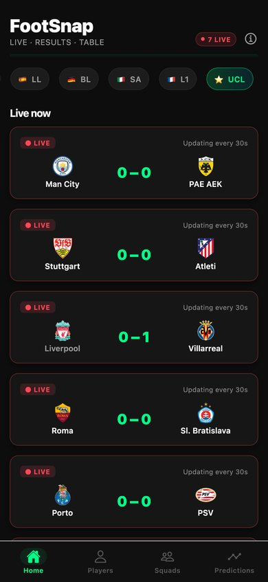
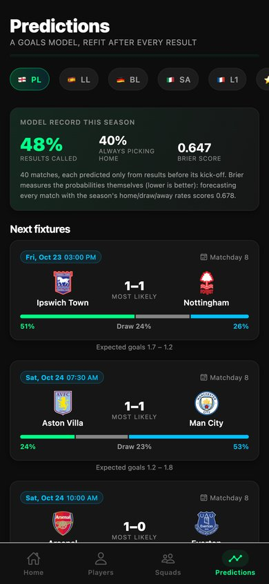
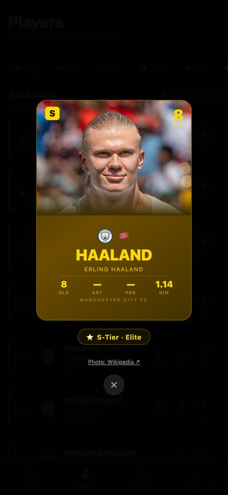
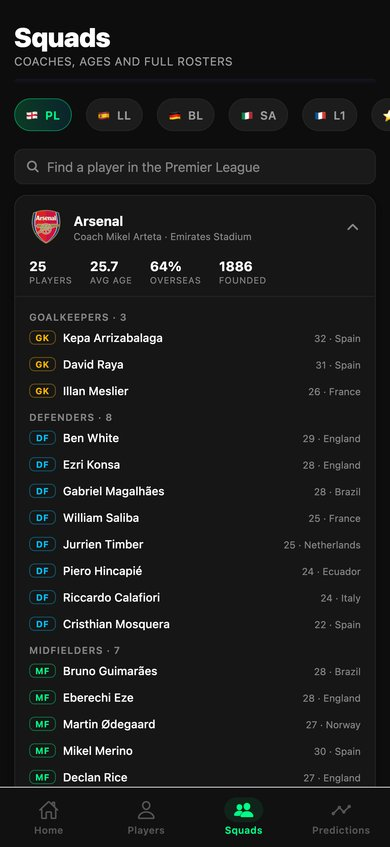

# FootSnap

[](https://github.com/otawfik/Footsnap/actions/workflows/ci.yml)

Live scores, tables, squads and match predictions for Europe's top five leagues and the Champions League.
An Expo / React Native app for iOS and Android, plus the same app on the web.

**Open it:** [footsnap-app.vercel.app](https://footsnap-app.vercel.app) (installable on a phone's home screen) ·
or run it in Expo Go (below).

<p>
  
  
  
  
</p>

<sub>Real data, captured from the live app on 20 October 2026.</sub>

## What it does

**Home**: live scores that refresh every 30 seconds while a match is on (and only then), the latest results,
the next fixtures with the model's home / draw / away odds and most likely score, and the table with each
competition's real zones (Champions League places, relegation, Bundesliga and Ligue 1's play-off spot, the
Champions League league phase's top 8 / play-offs / out) and form from actual results.

**Predictions**: a Poisson goals model fitted to the season so far. For each upcoming fixture, win / draw / loss
probabilities, expected goals and the most likely score; a strength ranking from each team's fitted attack and
defence; and **the model's record this season**, from a walk-forward test where every match is predicted only
from results before its kick-off, compared against always picking the home side and against base rates.
In the Premier League as of matchday 7, it had called 48% of 40 results against 40% for always picking home,
with a Brier score of 0.647 against 0.678 for base rates.

**Players**: the top 20 by goal contributions, each opening a player card with tier, goals, assists, penalties and
goals per match, and a photo from Wikipedia (credited and linked; only used when the article is about a
footballer, so a common name doesn't come back with a stranger's face).

**Squads**: every club's coach, squad size, average age and share of overseas players, the squad grouped by
position with ages, and a search across the whole league.

The league you pick follows you across tabs. Pull to refresh anywhere.

## The model

Goals are modelled as independent Poissons (Maher, 1982; the base of Dixon & Coles, 1997):

```
home goals ~ Poisson( mu_home · attack[home] · defence[away] )
away goals ~ Poisson( mu_away · attack[away] · defence[home] )
```

`mu_home` and `mu_away` are the season's average home and away goals, so home advantage is learned rather than
assumed. Attack and defence are fitted by iterative scaling, which converges to the maximum-likelihood fit while
accounting for who each team has played. A prior of four league-average games keeps early-season ratings from
swinging on two results. Outcome probabilities come from summing the 11 × 11 scoreline grid.

The record shown in the app is honest by construction: each finished match is predicted from a fit on matches
before its day, and scored on accuracy and multi-class Brier score against two baselines. Code:
[`lib/model.ts`](lib/model.ts). The unit tests check it against simulated seasons with known strengths: the fit
recovers the strength order and home advantage, and the walk-forward test beats both baselines when teams differ
and doesn't when they're identical.

## Architecture

```
app (iOS / Android / web)  ──►  /api/fd  (Vercel function)  ──►  football-data.org v4
                                 holds the API key
                                 path allowlist
                                 edge-cached per resource
```

- **The key never ships in the app.** It lives in the server's `FOOTBALL_DATA_KEY` environment variable. Earlier
  versions bundled it into the client, which on the web build meant anyone could read it.
- **One upstream request serves everyone.** The free tier allows 10 requests a minute. Each response is cached at
  Vercel's edge (fixtures 30 s, tables 2 min, scorers 15 min, squads 12 h), so that budget is shared across all
  users instead of spent per user. The app also de-duplicates in-flight requests and keeps short-lived copies, so
  switching tabs doesn't re-fetch.
- **When the free tier is busy, nothing breaks.** The edge keeps serving the last good copy (long
  stale-while-revalidate windows), and the app retries on its own once football-data.org's per-minute counter
  resets, using the reset time it reports.
- **Only four kinds of upstream path are allowed** (`competitions/{id}/matches|standings|scorers|teams` for the six
  supported competitions), with query parameters filtered, so the proxy can't be used as an open relay.

## Run it

```bash
npm install
npx expo start          # scan the QR code with Expo Go, or press i / a for a simulator
npm run test            # unit tests: model, football helpers, proxy rules
npm run typecheck
```

Expo Go and simulators talk to the deployed server, so no key is needed locally. To run your own server, deploy
this repo to Vercel, set `FOOTBALL_DATA_KEY` (free at
[football-data.org/client/register](https://www.football-data.org/client/register)), and point the app at it with
`EXPO_PUBLIC_API_BASE=https://your-deployment.vercel.app`.

CI typechecks, runs the tests and `expo-doctor`, and compiles the iOS, Android and web bundles on every push.
Releasing to the App Store and Google Play: see [`docs/app-store.md`](docs/app-store.md).

## Project structure

```
app/
  (tabs)/index.tsx        Home: live, results, fixtures with odds, table
  (tabs)/predictions.tsx  model record, fixture odds, strength ranking
  (tabs)/players.tsx      top scorers + player cards
  (tabs)/squads.tsx       clubs, coaches, squads, search
  about.tsx               data sources, privacy, support links
api/fd.ts                 the Vercel proxy
lib/                      pure logic, unit-tested
  model.ts                Poisson model, predictions, walk-forward backtest
  football.ts             live/results/upcoming split, form, zones, positions, ages
  proxy.ts                proxy allowlist and cache policy
  types.ts                football-data.org response types
services/api.ts           client: base URL, request de-duplication, short cache
hooks/useApi.ts           loading / error / refresh, polling while focused
public/                   privacy policy and support pages
```

## Data and credits

Football data from [football-data.org](https://www.football-data.org). Player photos from Wikipedia, credited
on each card. FootSnap is an independent app, not affiliated with any league, club or football-data.org.

React Native · Expo SDK 54 · Expo Router · TypeScript · Vercel Functions · Vitest
