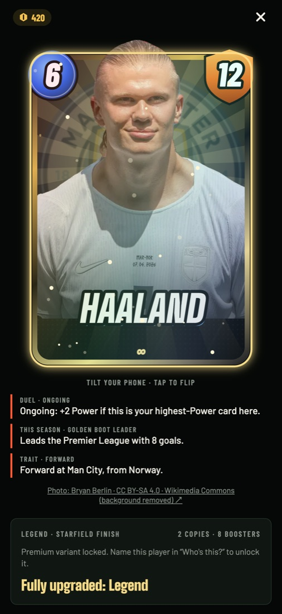
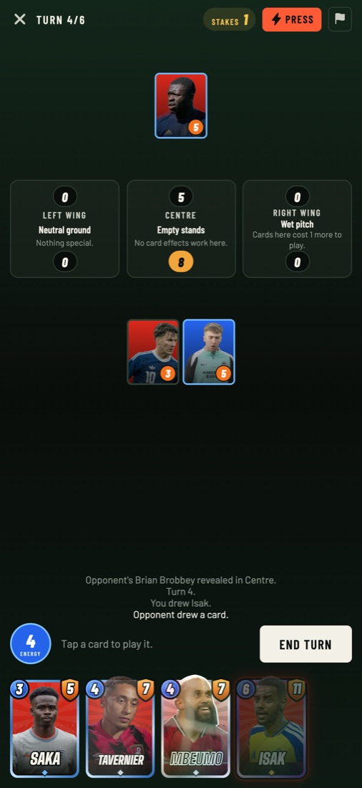
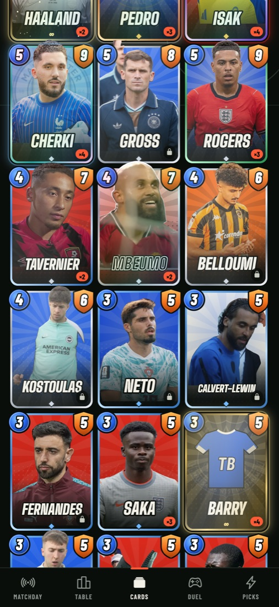
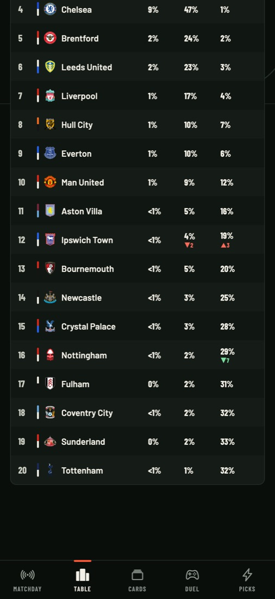

# FootSnap

[](https://github.com/otawfik/Footsnap/actions/workflows/ci.yml)

Football as a card game, built on real data. Every player in Europe's top five leagues and the Champions League is
a collectible card whose rarity and abilities come from real stats; the season can be replayed, simulated and
rewritten; every match comes with a model that shows its work. Expo / React Native for iOS and Android, plus the
same app on the web.

**Open it:** [footsnap-app.vercel.app](https://footsnap-app.vercel.app) · or run it in Expo Go (below) ·
releasing to the stores: [`docs/app-store.md`](docs/app-store.md), a step-by-step guide.

<p>
  
  
  
  
</p>

## What's in it

**Cards, inspired by Marvel Snap.** Every player has a card. Rarity is their rank by goals × 2 + assists (top 3 Icon,
4–10 Elite, 11–20 Rare). The big number is Power (goals × 2 + assists) or age. Abilities are always true statements
computed from the data, such as "Leads the Premier League with 8 goals", "3 of 8 goals from the penalty spot", or
"The only player from Japan in the Premier League". The art is
the player's own photo, cut out of its background so they stand in the card (and break out of the frame on rare
cards), over an animated background in the club's colours. Cards tilt with the phone's gyroscope, carry foil on
Elite and Icon, and flip to show full stats and exactly how each number was worked out.

**A collection system modelled on Marvel Snap's.** A free daily pack per league (odds shown, nothing to buy), credits
from packs, duplicates and correct picks, and boosters per card from duplicates. Spend them to upgrade a card
through seven tiers, each with a visible effect: Breakout (the player breaks out of the frame), Depth (3D parallax),
Pulse (animated glow), Crest, Holo, and Legend, a black-and-gold frame with a random Gilded, Prismatic, Crackle or
Starfield finish. A Collection Level with milestone rewards ties it together.

**Who's this?** A mystery card shows its cost, Power, rarity, position, age and club colours, with the player's
silhouette and the name hidden. Name the player from four options to unlock their **Premium** variant: a white
sticker outline around the player and an outlined name. Five a day.

**Duel, a card game with the cards you've collected.** Twelve-card decks, six turns, three zones of the pitch, each
with a condition revealed as the match goes on (Floodlights, Wet pitch, Derby, Counter-attack...). Both sides play
face down and reveal together. Win two zones to win. Every card's cost and Power come from the player's real
season, and abilities turn into effects (a top scorer gets stronger as your best card in a zone; a defender marks
the enemy's). Press to double the stakes when you think you're winning, or retreat to cut your losses. Decks are
built from your collection on a curve, topped up with loan players. The AI manager plays the same rules with a
deck of the same costs.

**The table, three ways.** The official standings; a **time machine** that replays the season matchday by matchday,
with rows gliding to their new places; and **odds** from 3,000 simulated seasons. The **what-if machine** lets you
set the score of upcoming games and re-simulates the rest of the season. Thanks to common random numbers, only the
clubs your result really affects move.

**Matches and clubs.** Live scoreboards with rolling digits and a goal flash; every fixture with home / draw / away
odds; match pages with a tappable scoreline heatmap, the points race and each side's key card; club pages with the
season's position chart, attack and defence ratings, projections and the squad as cards.

**Picks.** Call the next matchday, Press one pick to double the stakes (+4 or −2), and play against the model, whose
calls are made only from results before each match.

## The model

Goals are modelled as independent Poissons (Maher, 1982; the base of Dixon & Coles, 1997):

```
home goals ~ Poisson( mu_home · attack[home] · defence[away] )
away goals ~ Poisson( mu_away · attack[away] · defence[home] )
```

`mu_home` and `mu_away` are the season's average home and away goals, so home advantage is learned rather than
assumed. Attack and defence are fitted by iterative scaling, which converges to the maximum-likelihood fit while
accounting for who each team has played. A prior of eight league-average games keeps early-season ratings from
swinging on a handful of results. Outcome probabilities come from summing the 11 × 11 scoreline grid.

The record shown in the app is honest by construction: each finished match is predicted from a fit on matches
before its day, and scored on accuracy and multi-class Brier score against two baselines. Code:
[`lib/model.ts`](lib/model.ts). The unit tests check it against simulated seasons with known strengths: the fit
recovers the strength order and home advantage, and the walk-forward test beats both baselines when teams differ
and doesn't when they're identical.

**Season simulation.** Each simulated season redraws every team's strength around its fitted value (log-normal,
wider for teams with fewer games). Treating fitted strengths as certain made the simulator absurdly confident ten
games in: one side had a 95% title chance. Remaining fixtures are drawn from the model, added to the official
table, and ranked by points, goal difference and goals scored.

## Architecture

```
app (iOS / Android / web)  ──►  /api/fd  (Vercel function)  ──►  football-data.org v4
                                 holds the API key
                                 path allowlist
                                 edge-cached per resource
```

- **The key never ships in the app.** It lives in the server's `FOOTBALL_DATA_KEY` environment variable. Earlier
  versions bundled it into the client, which on the web build meant anyone could read it.
- **One upstream request serves everyone.** The free tier allows 10 requests a minute. Each response is cached at
  Vercel's edge (fixtures 30 s, tables 2 min, scorers 15 min, squads 12 h), so that budget is shared across all
  users instead of spent per user. The app also de-duplicates in-flight requests and keeps short-lived copies, so
  switching tabs doesn't re-fetch.
- **When the free tier is busy, nothing breaks.** The edge keeps serving the last good copy (long
  stale-while-revalidate windows), and the app retries on its own once football-data.org's per-minute counter
  resets, using the reset time it reports.
- **Only four kinds of upstream path are allowed** (`competitions/{id}/matches|standings|scorers|teams` for the six
  supported competitions), with query parameters filtered, so the proxy can't be used as an open relay.

## Run it

```bash
npm install
npx expo start          # scan the QR code with Expo Go, or press i / a for a simulator
npm run test            # 70 unit tests: model, simulator, cards and abilities, collection, packs, picks, proxy
npm run typecheck
```

Expo Go and simulators talk to the deployed server, so no key is needed locally. To run your own server, deploy
this repo to Vercel, set `FOOTBALL_DATA_KEY` (free at
[football-data.org/client/register](https://www.football-data.org/client/register)), and point the app at it with
`EXPO_PUBLIC_API_BASE=https://your-deployment.vercel.app`.

CI typechecks, runs the tests and `expo-doctor`, and compiles the iOS, Android and web bundles on every push.
Releasing to the App Store and Google Play: see [`docs/app-store.md`](docs/app-store.md).

## Project structure

```
app/
  (tabs)/index.tsx        Matchday: live scoreboards, fixtures with odds, results
  (tabs)/table.tsx        standings, time machine, projected odds, what-if machine
  (tabs)/cards.tsx        collection: level, daily pack, Who's this?, every player's card
  (tabs)/duel.tsx         Duel lobby: your deck, record, rules
  (tabs)/picks.tsx        picks with a Press, against the model
  card/[id].tsx           one card: tilt, flip, upgrade, Premium variant
  pack.tsx                opening the daily pack
  guess.tsx               Who's this?
  arena.tsx               the Duel board
  match/[id].tsx          scoreline heatmap, points race, key cards
  club/[id].tsx           position chart, ratings, projection, fixtures, squad cards
  about.tsx               data sources, privacy, support links
api/fd.ts                 the Vercel proxy (holds the football-data.org key)
components/
  SnapCard.tsx            the card: rarity frames, foil, tilt, flip, upgrade tiers, Premium
  ui.tsx                  design-system primitives
  Match.tsx, Charts.tsx   scoreboards, fixture cards, SVG line charts
lib/                      pure logic, unit-tested
  model.ts                Poisson model, odds, scoreline grid, walk-forward backtest
  season.ts               Monte Carlo season simulator (what-if pins), table replay, trajectories
  cards.ts                rarity, Power and abilities from real data
  game.ts, decks.ts       the Duel engine and AI; deck building
  art.ts                  player cut-outs (optional per build)
  collection.ts           credits, boosters, upgrade tiers, finishes, Collection Level
  packs.ts, guess.ts      daily packs; Who's this? puzzles
  picks.ts                scoring, the model's calls, you vs the model
  colors.ts               club colours from football-data.org's text
  football.ts, proxy.ts   helpers; proxy allowlist and cache policy
services/api.ts           client: base URL, request sharing, saved copies for offline, optional crest stripping
constants/theme.ts        the design system (colours with measured contrast, type)
public/                   privacy policy and support pages; art/ holds the player cut-outs
scripts/art/              the photo pipeline (below)
```

## Data and credits

Football data from [football-data.org](https://www.football-data.org). Player photos come from Wikimedia
Commons via each player's Wikipedia / Wikidata entry, credited on every card with the photographer, the licence and
a link. They're modified (cropped, background removed), and modified photos keep their original licence. A
photo is only used when the Wikidata birth date matches the squad's, so a namesake never ends up on someone
else's card. `scripts/art/` rebuilds the set; about 54% of players have one, and the rest get a shirt in their
club's colours. The App Store build leaves photos and crests out (see [`docs/app-store.md`](docs/app-store.md)). FootSnap is an independent app, not affiliated with any league, club or football-data.org.

React Native · Expo SDK 54 · Expo Router · TypeScript · Vercel Functions · Vitest
